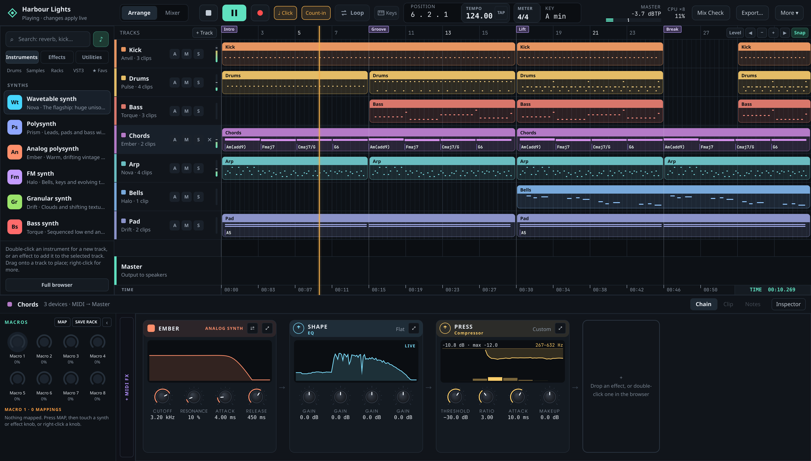
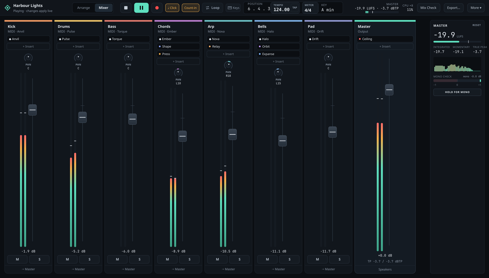
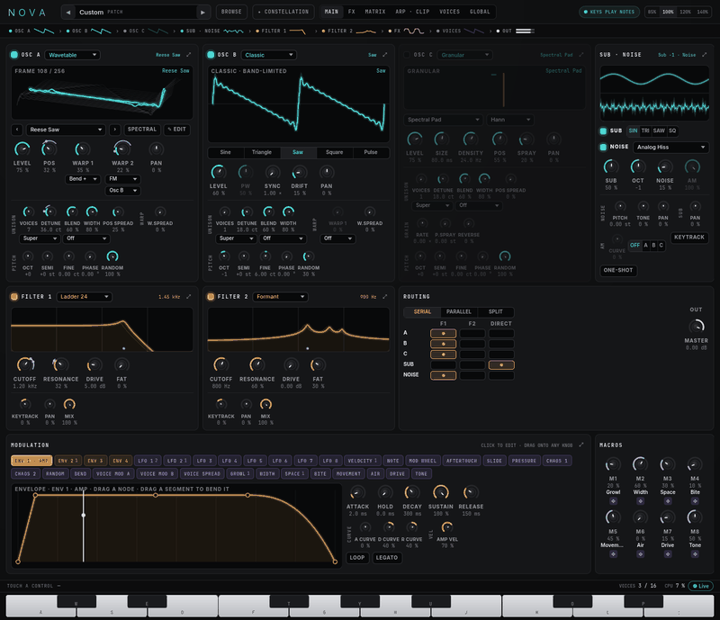
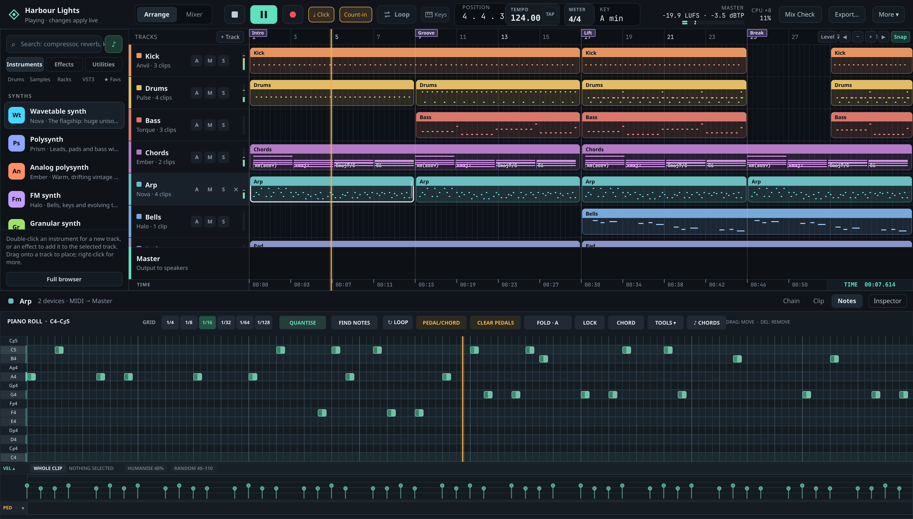

# Oscillate

Digital audio workstation for Linux. C++20 engine, project model, DSP, media
pipeline and VST3 host; Qt Quick user interface.

- **Platform:** Ubuntu 26.04 LTS, x86-64
- **Status:** pre-release; not yet release-qualified
- **Licence:** GPL-3.0-or-later

*The arrangement, with the selected track's device chain below.*

## Features

| Area | Contents |
| --- | --- |
| Arrangement | Audio and MIDI clips; notes, velocity, pedals (sustain, sostenuto, soft); markers; tempo and time-signature maps; chords as notes in MIDI clips ([ADR-0084](docs/decisions/0084-chord-clips.md)); Standard MIDI File import |
| MIDI recording | QWERTY keyboard input, overdub, metronome, one-bar count-in ([ADR-0086](docs/decisions/0086-midi-recording-and-click.md)) |
| Instruments | Prism, Ember, Nova, Pulse, Halo, Torque, Drift, Anvil, Knock, Crate; sampled: Concert, Fret, Wren |
| Effects | Contour, Forge, Orbit, Relay, Expanse, Vista, Deck, Pocket, Pump, Chop, Temper, Strata, Flyby, Dust, Shape, Press, Ceiling, Lens, Loudness, Scope, Tune, Trim, Signal; convolution reverb with `-DOSCILLATE_BUILD_CONVOLUTION_DSP=ON` |
| Mixing | Per-track source → inserts → output; buses, sends, returns, sidechains, delay compensation, macros, racks, freeze |
| Plugins | Linux VST3 instruments and effects; out-of-process scanning; saved state; X11-embedded editors |
| Audio editing | Tempo and key analysis, non-destructive warp and pitch, Clay note editing ([ADR-0081](docs/decisions/0081-clay-note-editing.md)), groove extraction, Arrange from loop |
| Automation | Track, clip, send and device lanes on the arrangement |
| Export | Master and stems as WAV; FLAC and MP3 with the codec adapter; offline Mix Check |

Not included: Session View, audio recording, hardware MIDI input.
Scope: [PRD](docs/PRD.md). Open work: [issues](https://github.com/jcsduncan/oscillate/issues).
Known problems: [known issues](https://jcsduncan.github.io/oscillate/known-issues/).

## Screenshots

*The mixer: one strip per track with its inserts, and the master meters.*

*Nova, the flagship wavetable synth ([spec 08](docs/specs/08-nova-synth.md)).*

*The piano roll, with velocity and pedal lanes.*

Every instrument and effect panel: [instruments](src/native_dsp/synth/README.md),
[effects](src/native_dsp/effects/README.md).

## Build

~~~sh
sudo apt-get install cmake ninja-build g++ pkgconf libpipewire-0.3-dev \
  libssl-dev nlohmann-json3-dev qt6-base-dev qt6-declarative-dev \
  python3 python3-venv
cmake --preset quick
scripts/build.sh build/quick --target oscillate
./build/quick/apps/daw_quick/oscillate
~~~

Command-line options: `--create FOLDER`, `--open FOLDER`. Projects are stored
in `~/.oscillate/projects/`.

`scripts/build.sh` caps memory under a user systemd manager and runs six
compiler jobs (`OSCILLATE_BUILD_JOBS` overrides).

### Optional features

| Feature | Packages | CMake options |
| --- | --- | --- |
| AIFF, FLAC, MP3 | `libsndfile1-dev` | `-DOSCILLATE_BUILD_CODEC_ADAPTER=ON` |
| VST3 host | pinned SDK ([setup](docs/dependencies/local-development.md)) | `-DOSCILLATE_BUILD_VST3_SCANNER=ON -DOSCILLATE_VST3_SDK_ROOT=<path>` |
| JACK output | `libjack-jackd2-dev` | detected automatically; `-DOSCILLATE_REQUIRE_JACK=ON` makes it mandatory |
| Resampling | `libsamplerate0-dev` | `-DOSCILLATE_BUILD_EXPORT_RESAMPLER=ON`, `-DOSCILLATE_BUILD_SOURCE_RESAMPLER=ON` |

Machine-specific paths go in `CMakeUserPresets.json` (ignored by Git).

## Sample libraries

Concert, Fret and Wren need sample libraries that are not in this repository.
The installers download a pinned release, verify it and convert it. They need
Python 3 and ffmpeg (with libsoxr for Fret and Wren); Concert and Fret also
need git.

| Instrument | Library | Licence | Installer | Location override |
| --- | --- | --- | --- | --- |
| Concert | Salamander Grand Piano V3 | CC-BY 3.0 | `python3 -I tools/concert/install_salamander.py` | `OSCILLATE_CONCERT_LIBRARY` |
| Fret | Karoryfer Black and Blue Basses (darkblack) | CC0 1.0 | `python3 -I tools/fret/install_black_and_blue.py` | `OSCILLATE_FRET_LIBRARY` |
| Wren | University of Iowa Musical Instrument Samples, flute | free use, no formal licence | `python3 -I tools/wren/install_iowa_flute.py` | `OSCILLATE_WREN_LIBRARY` |

Default location: `$XDG_DATA_HOME/oscillate/instruments/`
(`~/.local/share/oscillate/instruments/` when `XDG_DATA_HOME` is unset). An override must be set for both the installer and the
application. An instrument without its library loads and reports the library
as missing. Environment variables: [docs/environment.md](docs/environment.md).

## Tests

Tests write temporary files under `TMPDIR`; point it at the build tree.

Fast tier:

~~~sh
scripts/build.sh build/quick --target oscillate_tests
TMPDIR="$PWD/build/quick/scratch" QT_QPA_PLATFORM=offscreen \
  ctest --preset quick-fast -LE live -j4
~~~

All tiers except live devices:

~~~sh
scripts/build.sh build/quick --target oscillate_tests
TMPDIR="$PWD/build/quick/scratch" QT_QPA_PLATFORM=offscreen \
  ctest --test-dir build/quick -LE live --output-on-failure -j4
~~~

Single test:

~~~sh
scripts/build.sh build/quick --target oscillate_project_tests
TMPDIR="$PWD/build/quick/scratch" \
  ctest --test-dir build/quick -R '^project_contract$' --output-on-failure
~~~

Tiers: fast, slow, live. Sanitizer, coverage, format, tidy, benchmark and
device checks: [tests/README.md](tests/README.md), [AGENTS.md](AGENTS.md).
Documentation links: `python3 -I scripts/check-doc-links.py`.

## Layout

| Path | Contents |
| --- | --- |
| `apps/daw_quick/` | Application entry point, Qt adapters, QML |
| `include/oscillate/<module>/` | Public C++ interfaces |
| `src/<module>/` | Implementations |
| `tests/<module>/` | Unit, contract, integration and audio-oracle tests |
| `assets/starter/` | Generated starter audio and provenance |
| `tools/` | Generators, sample-library installers, analysis tools |
| `third_party/` | Vendored PFFFT and notices |
| `cmake/`, `scripts/` | Build configuration and quality tooling |
| `docs/` | Product, architecture, specifications, decisions, qualification |

Documentation: [index](docs/README.md), [HLD](docs/HLD.md),
[specifications](docs/specs/README.md). Contributing:
[CONTRIBUTING.md](CONTRIBUTING.md). Security: [SECURITY.md](SECURITY.md).

## Licence

GPL-3.0-or-later ([LICENSE](LICENSE)). Third-party components keep their own
licences: [third_party/](third_party/), [docs/dependencies/](docs/dependencies/).
