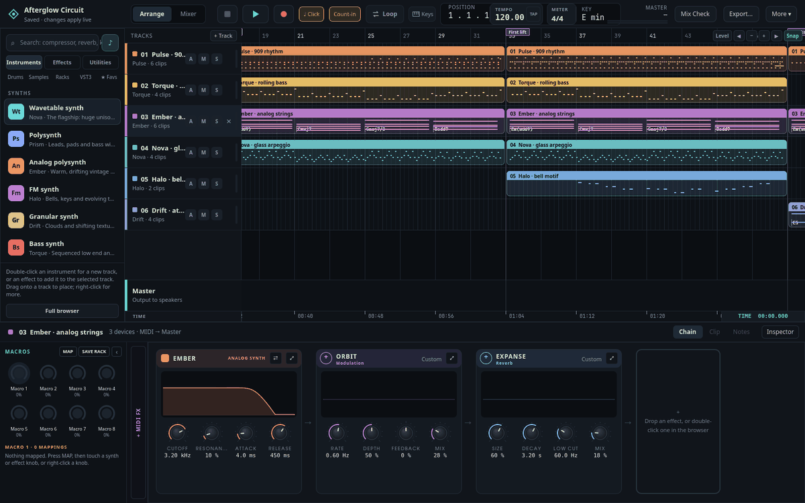
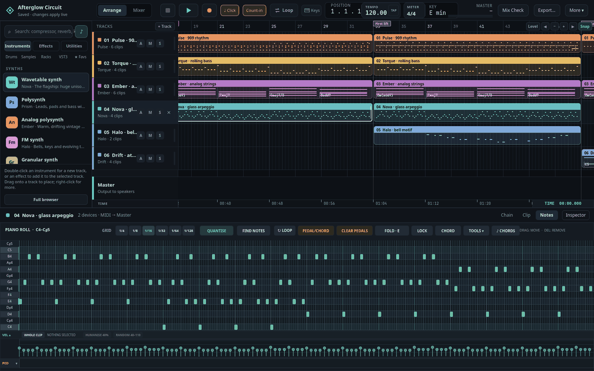
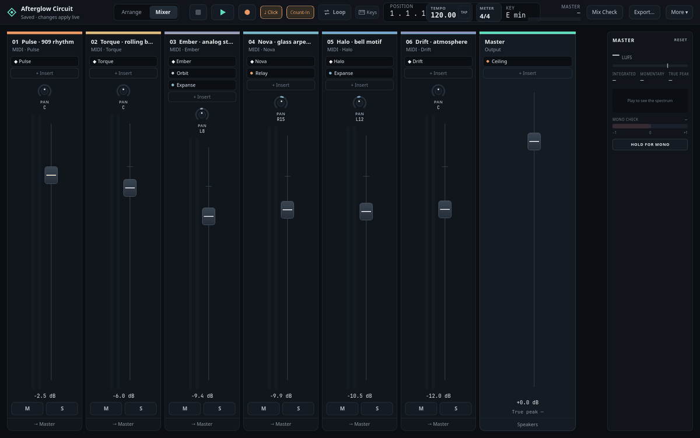

# Qt Quick desktop application

This directory owns the desktop composition and presentation layer. Product
behaviour is specified in the [functional specs](../../docs/specs/README.md);
the [HLD](../../docs/HLD.md) defines the boundaries with the engine and project
model. This file describes where to make a UI change.

*The shell: the browser on the left, the arrangement, and the selected track's
device chain in the dock below.*

*The dock's Notes tab: the piano roll, with velocity and pedal lanes.*

*The mixer view.*

## Structure

| Path | Responsibility |
| --- | --- |
| `main.cpp` | Parse launch options and start the application |
| `src/project_bridge*.cpp` | QML-facing project commands and read-model projection |
| `src/*_controller.*`, `src/*_view.*` | Feature-owned UI adapters and projections |
| `src/routed_playback.*`, `src/*_output.*` | Desktop audio-device composition |
| `src/native_synth_visuals.*`, `src/native_effect_visuals.*` | Panel-only curve and display data |
| `qml/` | Workspace, arrangement, mixer, device chain, overlays and panels |
| `qml/devicekit/` | Shared native-device controls and styling |
| `qml/<engine>/` | Engine-specific panel presentation |
| `tests/ui/quick/` | Shell, adapter, panel and interaction contracts |

The bridge is a compatibility facade, not a place for new feature logic.
Implement new workflows in a feature-owned controller and QML component, then
wire the smallest possible command and read model into the shell. Keep project
mutation in `application`/`project`; QML and Qt objects must not enter the audio
callback or core modules. UI scenario drivers belong in `tests/ui/quick/`, not
the production entry point.

## Local build and focused checks

Build and run the app as described in the README's
[Build](../../README.md#build) section. Build the affected UI
test targets, then select their CTest names or the `ui` label; the
[contributor guidance](../../AGENTS.md#commands) gives the test commands and
resource limits.

The Quick preset omits optional VST3 and encoded-audio dependencies unless
enabled locally. The [dependency setup](../../docs/dependencies/local-development.md)
explains those options. A display or physical audio-device test uses the `live`
CTest tier; ordinary adapter and panel contracts should run headlessly.

## Known boundaries

The bridge and parts of the arrangement remain large. Split along feature
ownership and a stable command/read-model interface when editing those areas;
avoid mechanical moves in playback-sensitive code. Native VST3 editor support
depends on plugin and window-system behaviour, and Wayland-native editor
support remains open.
