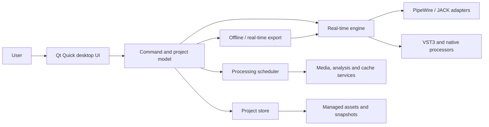

# Oscillate — High-Level Design

**Status:** Draft for review. Describes the current module boundaries, the native synth and effect platforms, the dependency choices and the known boundary violations (§3.1).

**Basis:** [PRD](PRD.md)

**Language:** C++20 throughout production C++ code

## 1. Scope and design rules

This design covers the v1 arrangement-first DAW. Session View, audio recording and hardware MIDI input are outside v1; MIDI recording from the computer keyboard is in scope ([ADR-0086](decisions/0086-midi-recording-and-click.md)). The HLD defines module boundaries and contracts; the [functional specifications](specs/README.md) define observable behaviour. A change to a PRD requirement needs a PRD edit and review, not a quiet implementation exception.

1. Audio rendering is independent of Qt, project I/O, and presentation code.
2. The real-time callback operates on an immutable graph plan and separately owned, bounded processor runtime state.
3. Every command has one authoritative model transition; UI, undo, save, and engine updates derive from it.
4. One timing implementation and one automation evaluator serve playback and export.
5. Essential project data is versioned and durable; analysis and render caches are disposable.
6. A missing plugin or media file retains its model identity and user edits.
7. Feature teams work behind reviewed interfaces; integration is continuous and release gates stay green.

## 2. System context

The process contains the UI, model, engine, and default plugin host. Plugin scanning uses a helper process. A separate execution process is an optional compatibility route for selected plugins, with explicit latency and fault limitations. The audio callback never waits for either helper.

## 3. Modules and dependency direction

| Module | Owns | May depend on |
| --- | --- | --- |
| `foundation` | IDs, errors, bounded value types, diagnostics interfaces, the performance tracer | C++ standard library |
| `timeline` | Beat/sample time, tempo and meter maps, conversions | `foundation` |
| `automation` | Automation curve evaluation | `timeline` |
| `project` | Tracks, clips, routing intent, commands, undo, versioned state | `foundation`, `timeline` |
| `automation_project` | Preparing project automation lanes into evaluated curves for playback and export | `automation`, `project`, `timeline` |
| `harmony` | Chord table, naming, voicing, the Progression Lab and chord-clip helpers ([ADR-0084](decisions/0084-chord-clips.md)) | `project`, `timeline` |
| `midi_file` | Bounded Standard MIDI File reader | `foundation` |
| `engine` | Render graph, scheduling, buffers, transport, PDC, meters, audio worker pool | `foundation`, `project` (immutable snapshots) |
| `routing` | Control-side compilation of project main/send intent into stable engine node and edge IDs and latency plans | `automation_project`, `engine`, `project` |
| `audio_io` | PipeWire and JACK adapters, transport cursor, metronome | `engine` interface |
| `codec` | Worker-only encoded-audio reader (libsndfile) | `foundation` |
| `media` | Import staging, source identity, decode/resample prefetch, per-clip rings, caches | `foundation`, `project`, `codec` |
| `analysis` | Waveform, tempo, key and Mix Check analysis | `media`, DSP primitives |
| `warp_dsp` | In-house stretch and pitch engine ([ADR-0026](decisions/0026-continuous-warp-stream.md)) | `foundation`, vendored PFFFT |
| `clay_dsp` | Note analysis and resynthesis of audio for Clay ([ADR-0081](decisions/0081-clay-note-editing.md)) | `foundation`, `warp_dsp` |
| `processing` | Warp maps, clip frame plans, verified source views, warp render cache, Clay sources | `foundation`, `media`, `project`, `warp_dsp` |
| `plugins` | VST3 discovery, instance lifecycle, state, parameter metadata, graph nodes | `foundation`, engine processor interface (see §3.1) |
| `native_dsp` | DSP primitives, built-in processors, the native synth platform (§8.1), note effects, the native effect platform (§8.2) and the optional convolution core | engine processor interface (see §3.1) |
| `native_inserts` | Preparing native effect and instrument stages for every chain builder ([ADR-0043](decisions/0043-one-native-insert-path.md)) | `project`, `engine`, `native_dsp`, `automation_project`, `timeline` |
| `track_chain` | One chain per track: instrument then inserts, prepared for live playback and export ([ADR-0050](decisions/0050-one-chain-per-track.md)) | `project`, `engine`, `routing`, `native_inserts` |
| `persistence` | Manifest codec, committed asset references, generations, recovery | `project`, `media`, `codec` |
| `source_prep` | Bounded control/worker decode of integrity-checked managed audio, for synth media slots and export | `engine`, `persistence`, `media`, `project`, synth engines |
| `export` | Offline render and format writers | `engine`, `routing`, `project`, `media`, `source_prep`, `persistence`, `processing` |
| `application` | Command dispatch, revisioned read models, recording, plugin browser/scan status, lifecycle services; the VST3 adapters that bind plugin hosts to routed playback, the session and offline export (`src/application/vst3`) | all modules above |
| `plugin_ui` (`src/app/plugin_ui`) | UI-thread VST3 run loop (`qt_vst3_run_loop`), editor attachment and X11 embedding | `plugins`, Qt |
| `apps/daw_quick` | Composition root, Qt Quick views and adapters, device setup, accessibility, diagnostics display | `application` APIs, `plugin_ui` |

The composition root (`apps/daw_quick`) wires runtime services across modules. This table is the intended dependency direction; §3.1 lists the deviations that remain. `media` stages imported bytes and validates identity; `persistence` commits generation references only after staged assets are durable. `source_prep` opens committed assets through `persistence` and decodes bounded sampler frames off the audio callback for both live and offline consumers. The current Quick executable composes `application` and Qt views. Qt and VST3 editor types must stay within UI-facing modules when `plugin_ui` is built. Public headers live under `include/oscillate/<module>/`; implementation and private headers live under `src/<module>/`.

### 3.1 Known boundary violations

The CMake graph does not yet enforce this table. These deviations are known and must be resolved or redesigned before the boundary is treated as enforced:

1. **native_dsp reaches above the engine interface.** `oscillate_synth_engines` links `automation_project` and `timeline`: the synth player compiles automation lanes and resolves project patches (`project_binding.cpp`).
2. **The native effect platform reuses synth types.** `native_effects` uses `synth::ParameterControl`, `TelemetryBuffer` and `SynthTransport`. This is an intended reuse, but the shared parameter/telemetry layer should become a neutral `native_dsp` component instead of living in the synth namespace.
3. **Convolution is still its own insert kind.** Every other built-in processor is a native effect engine on the shared insert path ([ADR-0047](decisions/0047-classic-processors-as-engines.md)), but the optional convolution reverb keeps type-specific branches in the routed playback control, offline export and the native insert stage.
4. **source_prep links the synth engines.** It decodes media slots of synth documents, so it depends on `native_dsp` rather than only on the engine interface.
5. **plugins reaches project types.** `vst3_project_binding` binds saved `project` plugin instances, and `vst3_graph_node` takes prepared `automation_project` lanes and a `timeline` tempo map, so `plugins` depends on more than `foundation` and the engine processor interface.
6. **export prepares chains itself.** `offline_master.cpp` builds track chains through `track_chain`, `native_inserts`, `native_dsp` and `automation_project`, which the table does not list for `export`.

## 4. State and command flow

The UI sends typed commands to a single project-model coordinator. A command constructs a private candidate, validates it using the shared timeline evaluator, creates one atomic model revision, records its inverse or prior state for undo, and publishes an immutable snapshot plus change set. Validation includes half-open rendered clip intervals across mixed timebases and rechecks all affected tracks after timing-map or rate edits. Continuous gestures are coalesced by gesture ID. Validation failure leaves the current revision, snapshot and undo depth unchanged. See [ADR-0008](decisions/0008-project-command-revisions.md).

The engine never reads mutable project objects. A non-real-time graph builder translates an accepted revision into immutable topology, routing and buffer plans. Mutable processor runtime state has a separate lifetime and stable instance ID. A transition plan identifies which running instances and compatible delay histories are reused, which must be replaced, and how affected output is handled. The audio callback activates a fully prepared plan only at a block boundary; old plans and non-reused runtime objects are reclaimed off the callback after their final use. See [ADR-0001](decisions/0001-processor-runtime-state.md) and [ADR-0002](decisions/0002-graph-publication.md).

Every model revision has an engine application state: `pending`, `active`, or `failed`, with the active graph revision recorded separately. A project edit can remain saved when its graph build fails, but playback retains the previous valid graph. The UI shows the intended project revision, active playback revision, failed change and reason, plus retry or undo. Pending or failed edits are never presented as audible. Export of an unapplied revision must explicitly build that revision or fail with the same diagnostic; it cannot silently render the previous graph.

Commands that accept a project edit before asynchronous media or plugin work first commit an explicit pending state. Completion installs results only when source identity, command generation, and settings still match. Cancellation or failure cannot install stale output. A managed-media import may instead stage and verify bytes as cancellable, model-neutral pre-command work. Its progress belongs to transient application status; only a current, verified completion creates one atomic source/track/clip command and undo step. Abandoning or rejecting the stage removes its private temporary file without changing the project revision.

## 5. Real-time engine

### Thread and callback contract

The audio callback performs no heap allocation, file I/O, logging formatting, UI call, plugin discovery, cache access, blocking lock, or wait on another thread. Atomics and bounded single-producer/single-consumer queues are the permitted callback cross-thread primitives; queue depth and any spin bound are set from worst-case measurement. Any plugin operation in the callback is treated as untrusted for timing; plugin CPU and fault diagnostics are recorded outside the callback. A fatal in-process plugin fault cannot be promised recoverable.

All graph nodes process planar floating-point blocks. The graph is a directed acyclic signal graph; cycles are rejected with an actionable routing error. Buffers come from a graph-owned pool sized during graph build. Nodes receive read-only input views and preallocated output views. No node retains a callback buffer past its block. Silence, bypass, and device-loss paths are bounded.

The `media` prefetch service owns file handles, decoders, source-rate conversion and lookahead workers. It fills preallocated per-clip rings tagged by clip and transport generation. Transport start or unanticipated seek enters a visible priming state while the control side waits a measured bounded deadline for minimum occupancy; timeout leaves playback stopped/paused without a counted underrun. Planned loop wraps are prefetched with the next-iteration tag while current frames remain valid. Only a shortfall in steady-state playback becomes callback silence, a bounded underrun count and an off-thread clip/interval report. The worker's lead target and priorities are measured with seek/loop stress; the callback never waits or invokes a media decoder or source resampler. See [ADR-0006](decisions/0006-prefetch-processing.md).

The engine has a monotonic sample transport position and a graph revision. Block scheduling splits or offsets events as needed so MIDI and automation can reach sample positions within a block. Latency and timebase conversions use the `timeline` module. Dynamic graph changes use cross-block handoff. A topology-only edit reuses compatible live processor instances so oscillator phase, plugin DSP history, delay tails and reverb tails continue. No instance is processed concurrently by old and new live graphs. Offline exports use separate processor instances restored from project state, never the live instances. A plugin or processor whose configuration cannot be reused is prepared off the callback from its saved state; if its live DSP history cannot be transferred safely, the transition uses a bounded tail-drain or fade policy and reports the limitation. It never silently resets a continuing processor.

### Routing and delay compensation

The graph builder topologically orders tracks, buses, sends, returns, sidechains, and the master. Each processor reports current latency. Longest-path analysis computes path alignment and allocates delay lines outside the callback. Compatible delay history is keyed by stable route/path identity and carried across graph revisions. Active paths retain a bounded, preallocated input-history ring sized to the approved PDC limit. A changed delay is prepared from a consistent history snapshot off the callback and primed before activation; the handoff plan keeps parallel paths aligned at the switch boundary. If the history is unavailable or cannot be captured consistently within the preparation deadline, activation waits or uses a bounded, documented fade/mute fallback and reports it. Delay lines retire only after no active path or tail drain references them. A plugin latency change requests a new plan; until compensation is ready, the affected path is held on a safe prior configuration or visibly muted/bypassed, never silently mixed at a known wrong offset. The builder rejects a path exceeding the configured compensation budget, preserves the old active graph where safe, and reports the affected path. The numerical budget is set from measured reference-workload evidence before PDC implementation is accepted. See [ADR-0005](decisions/0005-delay-compensation-transitions.md).

### Devices

PipeWire and JACK are separate adapters implementing the same device contract: enumerate, open, report requested client and actual graph/server rates, buffer size, lifecycle events and backend-supported xrun evidence. An unavailable per-stream count is reported as unknown rather than zero. PipeWire requests the project rate for its client stream; when the graph runs at another rate, PipeWire-managed conversion is accepted and reported in device status. JACK uses its fixed server rate, so a mismatch stops playback with instructions to change the server or project rate. The engine performs no whole-mix resampling. Stereo is the v1 output layout; there is no v1 hardware MIDI input. Notes recorded from the computer keyboard are placed at the project sample the player heard, using an audible-point timestamp each device callback publishes on the transport cursor ([ADR-0086](decisions/0086-midi-recording-and-click.md)). The metronome is attached only to main device playback, never to export. ALSA is a later fallback adapter if feasible. Device loss silences output, preserves transport and project state, and offers reselection. Audio I/O adapters own no project semantics. See [PipeWire rate properties](https://docs.pipewire.org/1.2/page_man_pipewire-props_7.html), [PipeWire stream API](https://docs.pipewire.org/group__pw__stream.html), [pw-top counter definitions](https://docs.pipewire.org/page_man_pw-top_1.html) and [JACK server-rate API](https://jackaudio.org/api/group__ServerControl.html).

## 6. Timing, clips, and automation

The `timeline` module owns distinct signed 64-bit tick and sample positions, with 960,000,000 ticks per quarter note, tempo and time-signature maps, and deterministic conversion APIs. The fixed scale is serialized with a format version. Tempo segments support constant, instantaneous, linear-BPM, and defined piecewise-linear ease curves. Meter events occur at bar boundaries and define continuous bar numbering and beat grouping, with no pickup bar in v1. Forward and inverse conversion have specified ties-to-even rounding and monotonicity tests. A single evaluator supplies playback, UI, MIDI, warp, automation, and export. See [ADR-0007](decisions/0007-timing-representation.md).

A project-rate change is a single stopped-transport command. Musical positions stay in beats; elapsed anchors retain exact time and their sample coordinates convert by an exact rational rate ratio with nearest-sample, ties-to-even rounding. The command is undoable, persists the new rate, invalidates rate-dependent caches/prefetch generations and renegotiates the adapter. Validation failure leaves the old revision active.

Clips refer to immutable source media IDs and carry per-instance trim, warp, pitch, fade, loop, timebase, and automation state. Same-track clip intervals are disjoint. Commands reject or constrain invalid overlaps before publishing a model revision. Ordinary fades operate within a clip.

Track automation and clip envelopes evaluate through the same curve code. A clip envelope takes precedence while active; at release the value returns to the track curve at that time, with parameter-specific de-click smoothing. Discrete parameters step. Smoothing is applied after semantic evaluation and must not shift event timestamps.

## 7. Media, processing, and caches

Import copies encoded originals into managed assets by default; explicit external links remain recorded with stable IDs. Each project has a nominal sample rate. Source media at another rate is converted in the prefetch worker for playback and in the export worker for renders; originals remain intact. Decoding, waveforms, BPM/key/onset analysis, warp suggestions, and derived audio run in background jobs. User corrections and selections are separate from generated suggestions. No analysis or cache operation mutates source media.

The scheduler has three priority classes from the PRD and a bounded worker budget. Playback prefetch and cache-miss adaptive stretch/pitch share the per-clip ring contract. Stretch/pitch runs in the lookahead worker, never the callback. If a worker falls behind during steady-state playback, it steps down to a documented lower quality before the bounded silence/underrun policy applies. Settings, rate or unanticipated seek changes invalidate stale ring generations; planned loop-wrap frames remain tagged for their next iteration. Job and cache identity include media version, project nominal sample rate, clip settings, algorithm/version, quality, and dependent tempo state. A new generation supersedes old jobs. Results are written to a temporary file, validated, then installed by atomic rename if their generation still matches. Cache indexes are rebuildable. Eviction touches only reconstructable cache files, never managed assets, external links, snapshots, or exports.

If a cache is absent, playback uses the prefetch-worker adaptive path where possible and reports quality reduction. Source-only waveform, BPM, key and onset summaries may be reused from a private per-user content-addressed cache after the current source passes full identity verification; project-specific corrections remain in the manifest. Clip-instance processing stays in the project-local cache. A per-user cache registry tracks known project-local cache directories and the shared source-analysis store once for the final global budget. Unreachable or moved project paths are dropped from budget accounting; the cache manager never deletes an unreachable path. Offline render uses the highest available quality and fails with an actionable error when a required result cannot be produced. Stretch, formant, pitch, codec and analysis choices still need complete recorded-material quality, CPU and redistribution evidence before release.

## 8. Plugins and native processing

VST3 scanning occurs in a helper process. The scanner validates metadata and state size, records crashes/timeouts, and quarantines repeated failures. Host execution defaults to in-process. A per-plugin isolation route may be added for compatibility; it is not a hard crash-containment guarantee. The current generic `ProcessorRuntime` API processes a stereo block with `BlockContext`; VST3 adapters carry MIDI, parameter events, state, latency and bypass through their own preparation and runtime types. A unified host/editor API remains a design goal. The UI-thread editor bridge supplies the VST3 Linux run loop for timers and file descriptors and handles native-window attach/detach; Qt and VST3 editor types stay outside the generic processor API. X11 embedding is implemented. XWayland and optional VST3 3.8 native Wayland interfaces need representative plugin qualification on Ubuntu 26.04. Failed attachment offers a generic parameter view with a reason. See the official [Linux run-loop](https://steinbergmedia.github.io/vst3_dev_portal/pages/Technical%2BDocumentation/Provide%2BA%2BRunloop%2BOn%2BLinux/Index.html) and [Wayland interface](https://steinbergmedia.github.io/vst3_dev_portal/pages/Technical%2BDocumentation/Change%2BHistory/3.8.0/IWaylandHost.html) documentation.

Unknown or missing plugins become placeholders holding the exact plugin identity, opaque state, parameter references, automation links, routing position, and latency last known. Relinking is an explicit user action and must preserve surrounding project state. Built-in effects and instruments implement the same processor API; they do not depend on VST3.

The `plugin_ui` target (`src/app/plugin_ui`) owns the editor bridge. It provides the VST3 Linux run loop on the Qt UI thread (`qt_vst3_run_loop`), editor attach/detach (`vst3_editor_attachment`) and X11 embedding (`x11_embed`). The Quick app opens native VST3 editors through it (`Vst3NativeEditorOverlay.qml`). Wayland-native editors remain unimplemented.

### 8.1 Native synth platform

`oscillate_native_synth` holds the reusable, engine-agnostic DSP blocks: oscillators, oversampling, filters, chorus, wavetable, FM, drum, bass, grain and modal primitives. It depends only on `foundation`. `oscillate_note_effects` holds the MIDI note effects ([ADR-0059](decisions/0059-play-and-sparkle.md)).

`oscillate_synth_engines` holds:
- the generic `NativeSynthRuntime`;
- the engine registry (`src/native_dsp/synth/engines.cpp`): Prism, Ember, Nova, Pulse, Halo, Torque, Drift, Concert, Anvil, Crate, Knock, Fret and Wren;
- the project binding;
- the `NativeSynthPlayer` used by live playback and export.

Each engine is a versioned parameter table (`EngineDescriptor`), factory presets and a `SynthKernel` (control tick, note on/off, pedal, render, reset, telemetry).

The project stores a `NativeInstrumentPatch` (engine id, table version, named values). Newer table versions fail with an actionable error.

Real-time contract:
- Kernels are created and sized on control, and never allocate on the callback.
- Control values are adopted at fixed control ticks aligned to project frames, so any block split renders identically and export equals live playback.
- A kernel that streams content from disk (the Concert, Fret and Wren sample libraries; ADR-0071, ADR-0088, ADR-0089) reads it on a worker thread into preallocated rings; offline renders call `await_content` between blocks so they never outrun the disk, and the callback never waits.
- Automation lanes, stepped lanes ([ADR-0034](decisions/0034-stepped-native-automation.md)) and pedal events ([ADR-0035](decisions/0035-pedals-in-midi-clips.md)) are delivered sample-accurately.
- Telemetry goes through a bounded lock-free buffer for panels ([ADR-0037](decisions/0037-synth-telemetry.md)).
- Structural parameter changes switch live ([ADR-0038](decisions/0038-live-structural-switching.md)).

### 8.2 Native effect platform

`oscillate_native_effects` (`src/native_dsp/effects/`, [ADR-0040](decisions/0040-native-effect-platform.md)) provides one generic `NativeEffectRuntime` and an `EffectEngine` registry (`src/native_dsp/effects/registry.cpp`): Contour, Forge, Orbit, Relay, Expanse, Vista, Deck, Pocket, Pump, Chop, Temper, Strata, Flyby, Dust, Lens, Loudness, Scope, Tune, Trim, Signal, Shape, Press and Ceiling. Effects with editable curves or shapes carry a document as synths do ([ADR-0058](decisions/0058-pump-volume-shaper.md)).

Each engine supplies:
- a parameter table and factory presets;
- a kernel factory;
- tail and latency functions;
- `sidechain` and `generator` flags.

The runtime shares the synths' parameter control, lanes and telemetry. Its real-time contract matches §8.1: no callback allocation, project-frame-aligned control ticks, block-split invariance, and reset on a transport-generation change.

**Integration.** Every native effect uses one insert type, an adapter to the sidechain processor runtime, and the chain builder in `native_inserts`/`track_chain` that live playback and export share ([ADR-0043](decisions/0043-one-native-insert-path.md), [ADR-0050](decisions/0050-one-chain-per-track.md)). Live playback can render one heavy synth's voices on free audio helpers ([ADR-0085](decisions/0085-nested-voice-rendering.md)); denormals are flushed at every render entry ([ADR-0062](decisions/0062-denormals-flushed.md)).

## 9. Project format and recovery

The project is a directory with a human-readable versioned manifest, managed `assets/`, `state/` generations including autosaves and named revisions, and disposable `cache/`. The manifest references stable IDs and content hashes rather than raw path identity. Large plugin states may be separate bounded blobs referenced by hash. The current greenfield codec accepts only its current schema and rejects unknown fields or unsupported versions without rewriting data.

A save writes a complete new generation to a temporary location, flushes files and directory metadata, then atomically advances a small current-generation pointer. Startup chooses the last complete generation. Autosave and named revisions refer to complete generations. Before the first public beta, only the current development schema is accepted. Once a project schema has shipped publicly, migration starts from a backed-up generation, validates the result, and keeps rollback data. Recovery presents the last saved state and latest valid autosave separately. The detailed on-disk protocol and failure matrix are fixed in the persistence specification before file-writing code is merged.

## 10. UI, export, and diagnostics

Qt 6 Core, Gui, Quick and Qml are the production UI direction under [ADR-0022](decisions/0022-qt-quick-ui-direction.md), dynamically linked and isolated in `apps/daw_quick` and `plugin_ui`. The Quick executable also links Qt Widgets for native file dialogs (`QFileDialog`, `apps/daw_quick/CMakeLists.txt`), so Widgets is in the Qt distribution review. Qt Multimedia and Qt audio processing are not used. Timeline, waveform, automation, and meters use purpose-built views backed by immutable read models. Rendering and analysis work stay off the audio callback. Keyboard access, accessible names, scalable type, high contrast, saved panel layouts, and non-colour indicators are component acceptance criteria.

Offline and real-time export both request an engine render snapshot from the same project revision. Export reuses timing, graph, automation, and PDC code; only the driving clock, quality policy, and writer differ. Output sample-rate conversion runs in the writer worker. A real-time export xrun fails the render without replacing a previous valid output. Stems include routing effects and tails. Export records format, bit depth, sample rate, revision, warnings, and processing quality in a report.

Diagnostics use bounded event capture and non-real-time formatting. Crash/performance sharing is opt-in; diagnostic bundles are previewed before export. Paths are redacted in shared reports by default.

## 11. Dependency and licensing decisions

| Item | HLD decision | Gate before implementation or release |
| --- | --- | --- |
| Project licence | GPL-3.0-or-later | Every dependency compatible with it and with binary distribution |
| C++ | C++20, no compiler extensions | GCC and Clang local builds |
| Build | CMake 3.28+, Ninja, target-based flags and dependencies | Configure/build/test/coverage/sanitizer presets |
| UI | Qt 6 Core/Gui/Quick/Qml direction, dynamic linking | Confirm exact modules, versions, LGPL obligations, AppImage and package compliance before UI distribution |
| VST3 | Steinberg SDK 3.8+ candidate | Pin exact MIT-licensed SDK release and inventory bundled files/trademarks before host code |
| Audio I/O | PipeWire and JACK adapters | Device and callback contract tests on Ubuntu 26.04 |
| DSP/media codecs and resampler | Worker-only libsndfile 1.2.2+ decoder adapter ([ADR-0016](decisions/0016-encoded-audio-codec-boundary.md)). Export encoding also uses libsndfile (`src/export/encoded_writer.cpp`: FLAC 16/24 and MP3 through libsndfile's MPEG layer III support). libsamplerate does source-rate conversion in `media` (`SRC_SINC_MEDIUM_QUALITY`, `source_rate_reader.cpp`) and export output conversion (`SRC_SINC_BEST_QUALITY`, `src/export/master_output.cpp`). Stretch and pitch are the in-house `warp_dsp` engine ([ADR-0026](decisions/0026-continuous-warp-stream.md)). PFFFT v1.1.0, vendored in `third_party/pffft` with one allocation-failure patch, is used by warp and the opt-in convolution core ([ADR-0020](decisions/0020-convolution-reverb.md)). | Package, licence and patent/redistribution review (MP3 encoding included) remains a release gate |
| DSP acceleration | DAW-owned hot loops with a measured CPU baseline; runtime-dispatched SIMD where beneficial; optional CUDA for batchable background/offline work with CPU fallback. ORC is not a selected dependency. | Audio-oracle equivalence, launch/transfer cost and failure tests; no GPU wait in the audio callback |
| Tests | CTest plus module tests, GCC/gcovr line coverage | 90% aggregate gate, component risk tests and release qualification |

Qt's own licensing page notes that module terms differ, so module selection is a release-blocking review rather than a blanket Qt approval. Steinberg documents MIT terms for VST3 SDK 3.8 onward; the actual vendored release and included files still need inventory. See [Qt licensing](https://doc.qt.io/qt-6/licensing.html) and [VST3 licensing](https://steinbergmedia.github.io/vst3_dev_portal/pages/VST%2B3%2BLicensing/VST3%2BLicense.html).

## 12. Design review gates and open measurements

Before implementation of the affected module, approve: tick scale, meter map and conversion tolerances; graph update and reclamation proof; PDC budget and failure behaviour; exact project schema and crash-write protocol; cache key/version format; plugin helper and editor-bridge protocol; selected DSP/codec/resampler libraries and product-licence path; Qt distribution obligations; reference hardware/plugin set and acceptable xrun measurement. Open gates are [issues labelled release-gate](https://github.com/jcsduncan/oscillate/issues?q=is%3Aissue+is%3Aopen+label%3Arelease-gate). No feature may declare completion while its relevant gate is open.

The HLD remains a draft until component contracts and the reference qualification method have been reviewed. Architectural changes require an ADR in `docs/decisions/` and updates to the affected spec and tests.
