# Effects

The native effects. Each one is a parameter table and a DSP kernel run by the
native effect platform ([ADR-0040](../../../docs/decisions/0040-native-effect-platform.md)),
with its own Qt Quick panel in `apps/daw_quick/qml/<engine>/`. The screenshots
come from the panel tests in `tests/ui/quick/`, with telemetry from the real
effect or a test frame.

## Filter, drive and modulation

### Contour

Multimode filter from the synths' filter models (SVF, ladder, OTA, SEM, comb),
with a tempo-synced LFO and an envelope follower on the input or the sidechain.
[ADR-0040](../../../docs/decisions/0040-native-effect-platform.md)

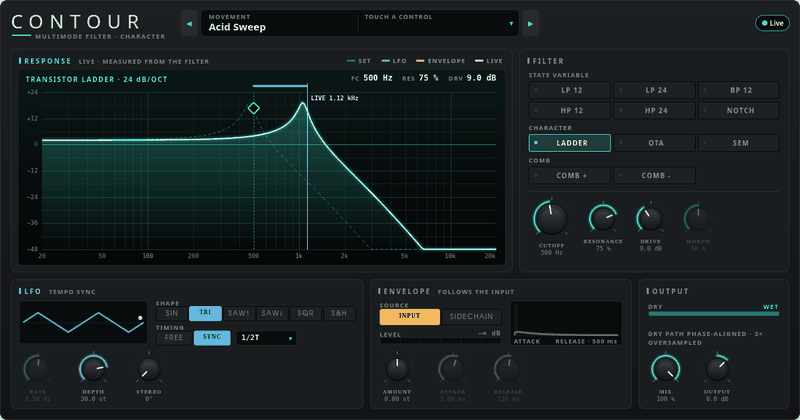

### Forge

Saturation: eight antialiased curves (tape, tube, transistor, diode, clip,
two folds, rectify) at 16x oversampling, with colour and auto gain.
[ADR-0040](../../../docs/decisions/0040-native-effect-platform.md)

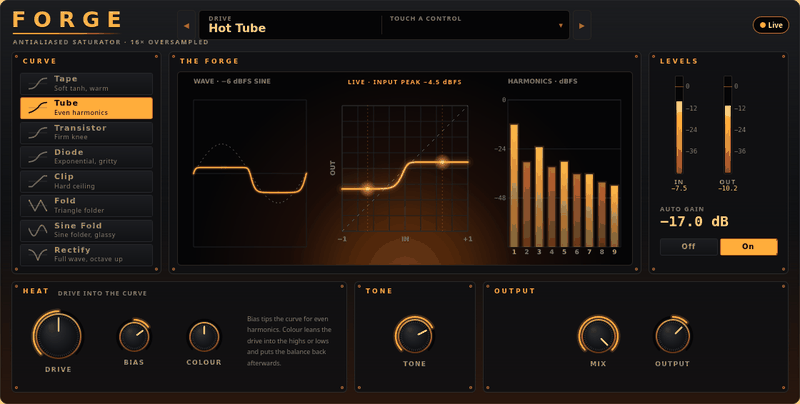

### Orbit

Modulation: chorus, string ensemble, dimension, flanger, phaser, vibrato and
tremolo or auto-pan from one tempo-syncable LFO.
[ADR-0040](../../../docs/decisions/0040-native-effect-platform.md)

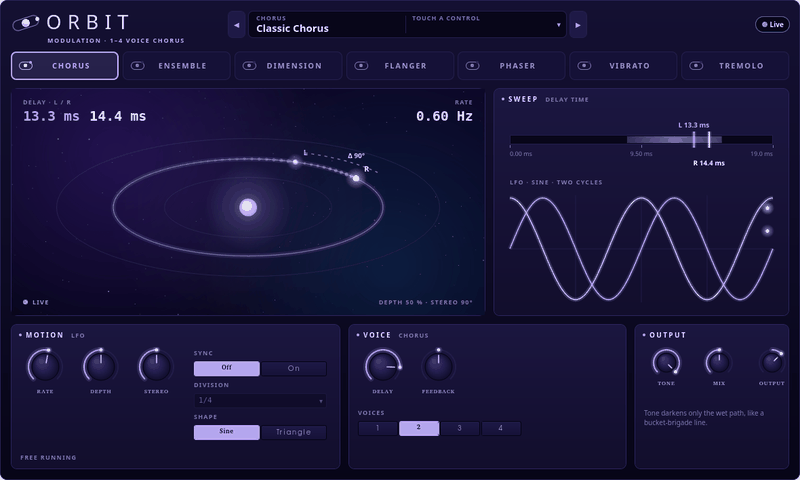

### Chop

Tempo-locked gate and stutter: 16 or 32 steps, each with a level, gate length,
ratchets, a repeat and a chance.
[ADR-0075](../../../docs/decisions/0075-chop.md)

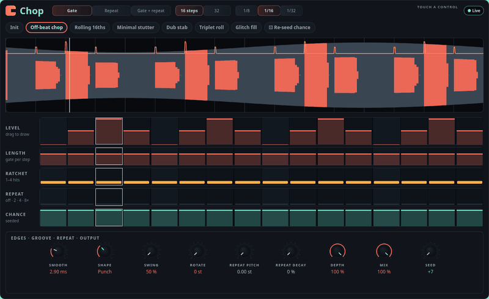

### Flyby

A sound travelling along a path past the listener, with Doppler shift, the
time and level between the ears, and air absorption.
[ADR-0067](../../../docs/decisions/0067-flyby.md)

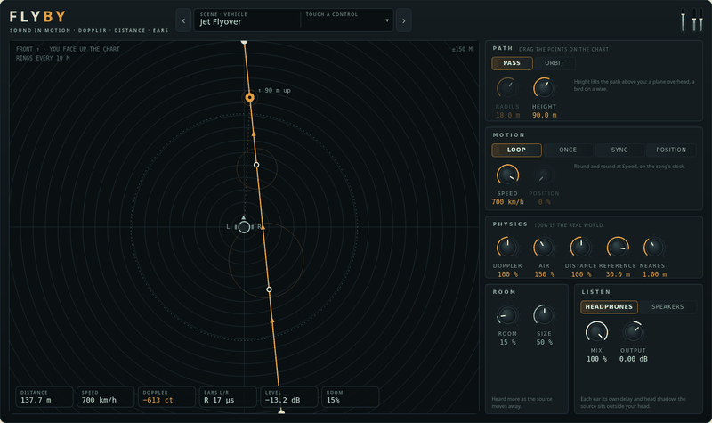

### Dust

Background texture and ageing: eight synthesised layers (vinyl, tape, hum,
radio static, rain, wind, room tone, machines) that duck under a sidechain,
and wear, wow and flutter on the signal passing through.
[ADR-0069](../../../docs/decisions/0069-dust-texture.md)

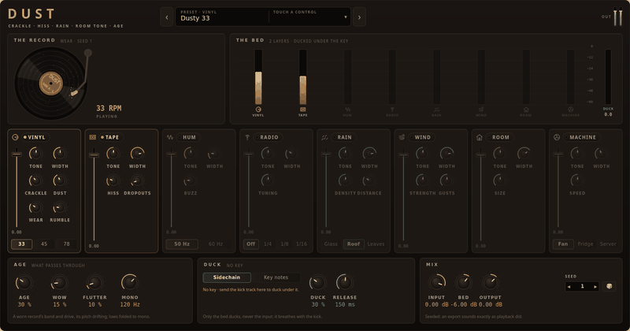

## Delay and reverb

### Relay

Stereo, ping-pong or mono delay up to four seconds, free or tempo-synced, in
digital, tape or analogue modes.
[ADR-0040](../../../docs/decisions/0040-native-effect-platform.md)

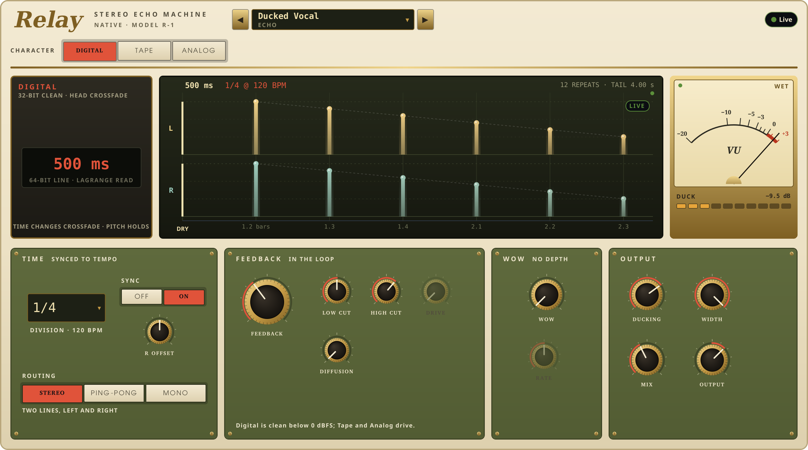

### Expanse

Algorithmic reverb with six spaces (room, hall, plate, chamber, cathedral,
cloud) on a 16-line feedback delay network, with freeze.
[ADR-0040](../../../docs/decisions/0040-native-effect-platform.md)

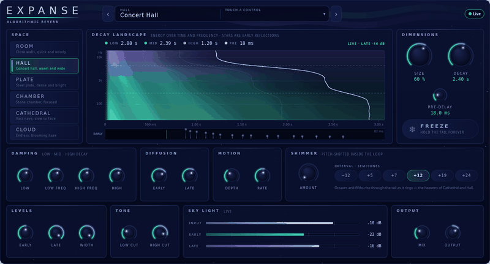

### Cast

Convolution reverb with zero latency: bundled modelled rooms, halls, plates and
a spring, or a user's IR (mono, stereo, or true stereo from two stereo files),
shaped by start, length, stretch, decay, fade in and reverse, with pre-delay,
tone, width and ducking.
[ADR-0115](../../../docs/decisions/0115-cast-convolution-reverb.md)

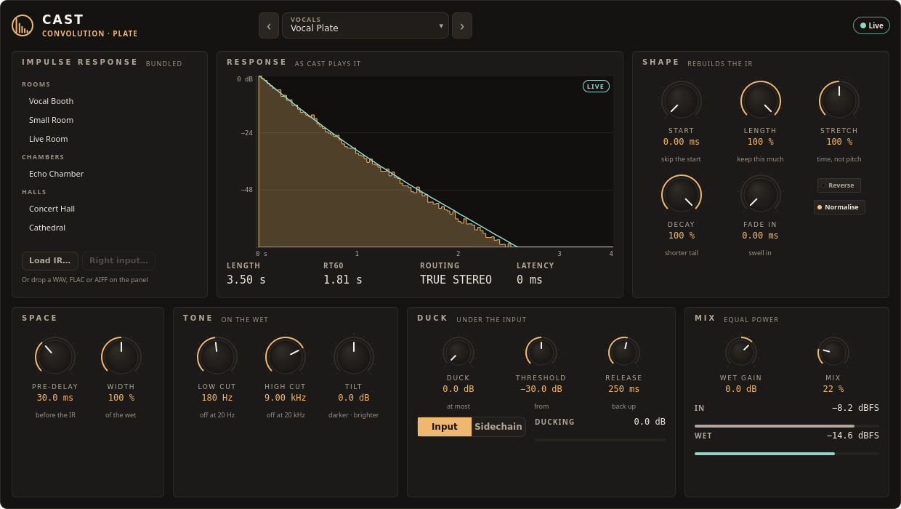

## EQ and dynamics

### Shape

Eight-band EQ with shelves, bells and pass filters up to 96 dB an octave.
[ADR-0047](../../../docs/decisions/0047-classic-processors-as-engines.md)

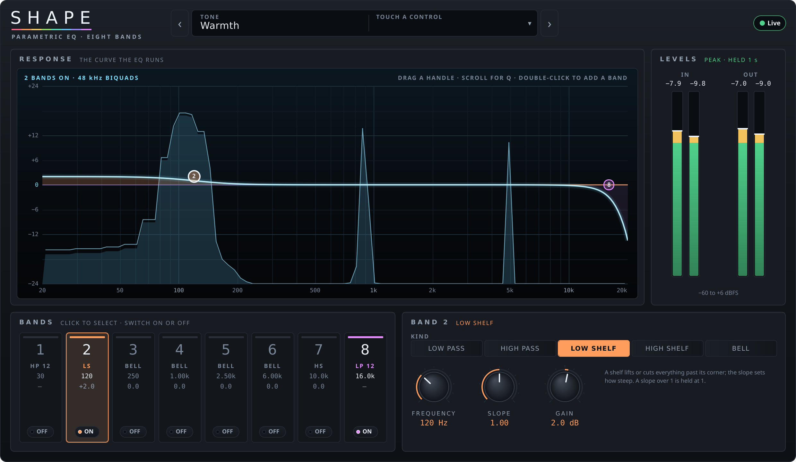

### Press

Compressor with threshold, ratio, knee, attack, release, makeup and a
sidechain-keyable detector.
[ADR-0047](../../../docs/decisions/0047-classic-processors-as-engines.md)

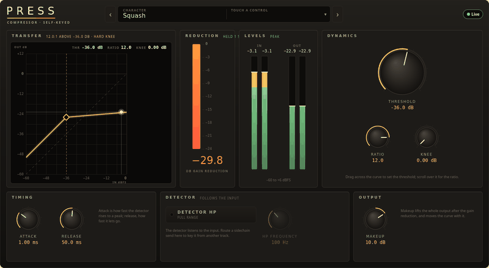

### Ceiling

True-peak mastering limiter: a lookahead gain stage whose fast envelope
releases to a slow loudness stage, onsets let through to an 8× oversampled
soft clipper, a BS.1770 true-peak guard, separate sustain and transient stereo
links, and the output's loudness against a target that Gain can learn.
[ADR-0117](../../../docs/decisions/0117-ceiling-mastering-limiter.md)

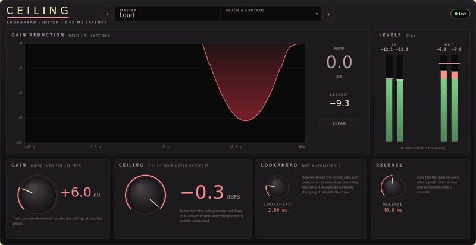

### Strata

Multiband dynamics: up to six bands, each with one transfer curve that
compresses or expands above its threshold and lifts or pushes down below it.
[ADR-0082](../../../docs/decisions/0082-strata-multiband.md)

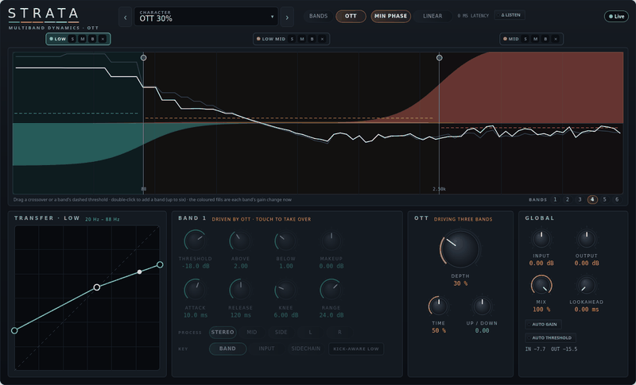

### Edge

Clipper for drums and the master: input drive into a ceiling of −12 to
0 dBFS, one shape from a hard flat top to a soft knee, 1x to 16x
linear-phase oversampling, a true-peak guard that keeps the output at or
under the ceiling, delta, stereo link and a level-matched compare.
[ADR-0108](../../../docs/decisions/0108-edge-clipper.md),
[ADR-0113](../../../docs/decisions/0113-edge-adjustable-ceiling.md)

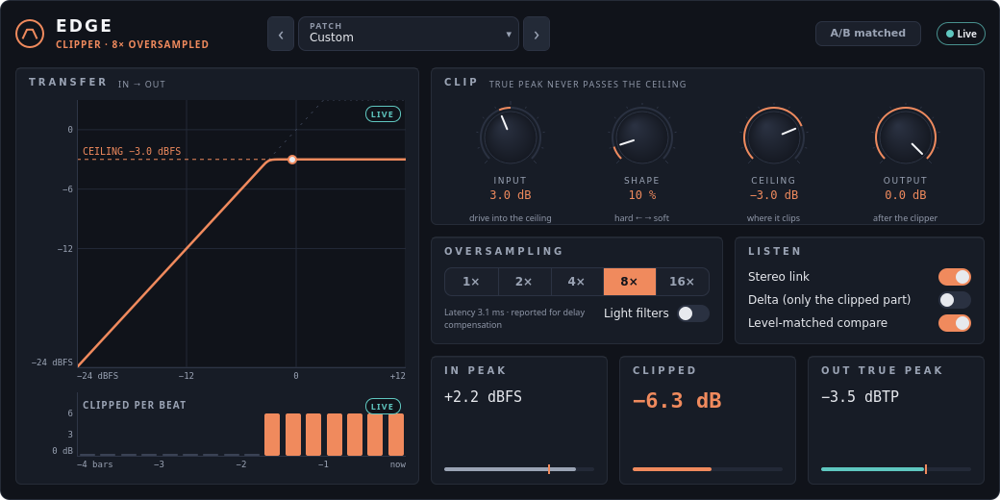

### Hush

Gate and downward expander: hysteresis and hold so it never chatters,
lookahead, a range down to a full mute, a key filtered by a high-pass and
low-pass or taken from a sidechain, stereo link, listen and flip.
[ADR-0116](../../../docs/decisions/0116-hush-gate-expander.md)

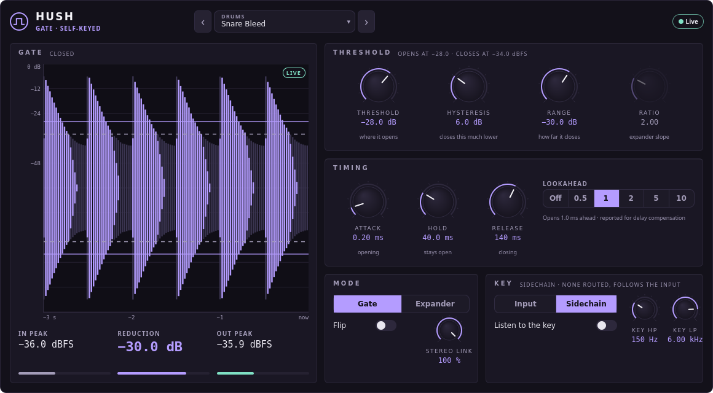

### Strike

Transient shaper: attack and sustain gains that do not depend on the
level, single-band or in up to four bands (Linkwitz-Riley or linear phase),
with attack and sustain times, lookahead, stereo link, mix, solo per band
and an oversampled clip under a ceiling.
[ADR-0118](../../../docs/decisions/0118-strike-transient-shaper.md)

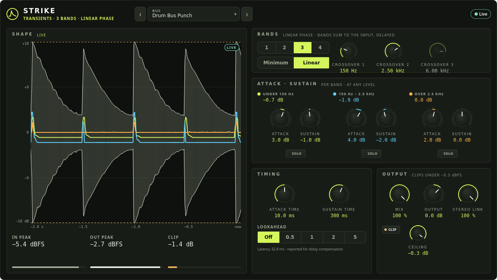

### Keel

Adaptive tonal balance: tracks the programme's third-octave balance over
Speed seconds, gated against silences and bursts, and steers it toward a
target (a tilt, a drawn, learned or genre curve, or a reference on the sidechain)
with minimum-phase shelves and bells and no latency. Amount, the limits,
region weights, Level Match and Delta.
[ADR-0119](../../../docs/decisions/0119-keel-adaptive-tonal-balance.md)

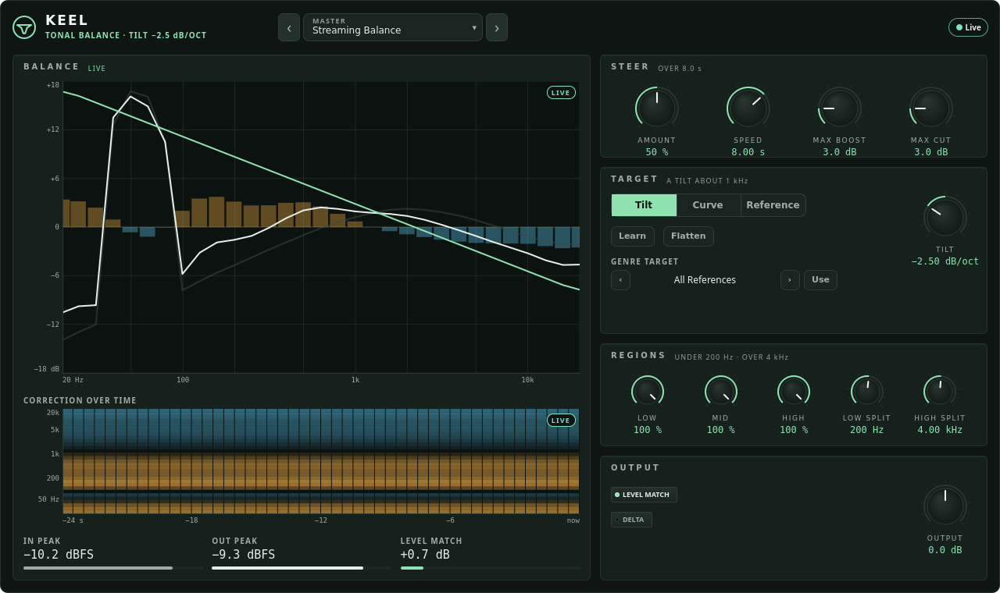

### Temper

Resonance suppressor with dynamic EQ bands and a drawn sensitivity curve.
[ADR-0064](../../../docs/decisions/0064-temper-resonance-suppressor.md)

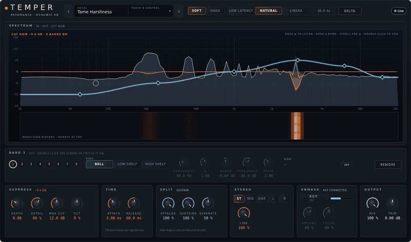

### Deck

DJ mixer three-band isolator: Linkwitz-Riley crossovers, each band from a full
kill to +6 dB, with kill switches.
[ADR-0055](../../../docs/decisions/0055-deck-dj-isolator.md)

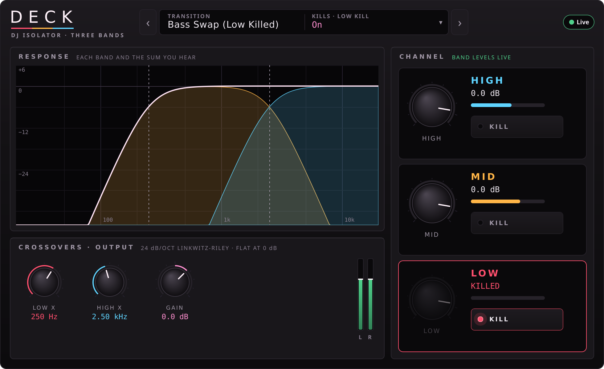

## Sidechain

### Pocket

Kick and bass masking resolver: on the bass, keyed by the kick, it ducks the
bass in the bands where the kick needs room.
[ADR-0041](../../../docs/decisions/0041-pocket-kick-bass.md)

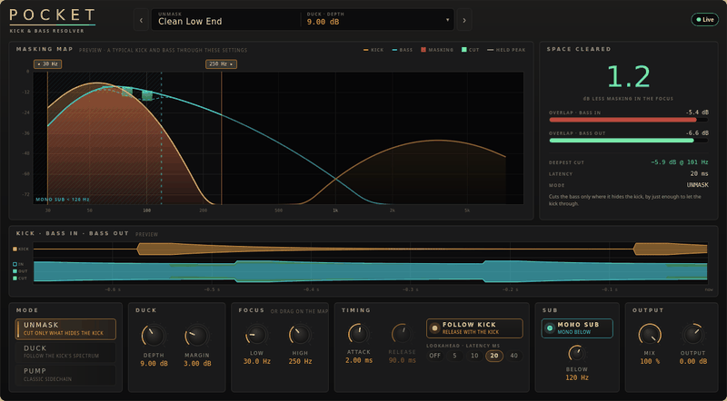

### Pump

Volume shaper for sidechain pumping: one cycle's volume is a curve drawn over
the kick it follows, restarted on the grid or on each detected kick.
[ADR-0058](../../../docs/decisions/0058-pump-volume-shaper.md)

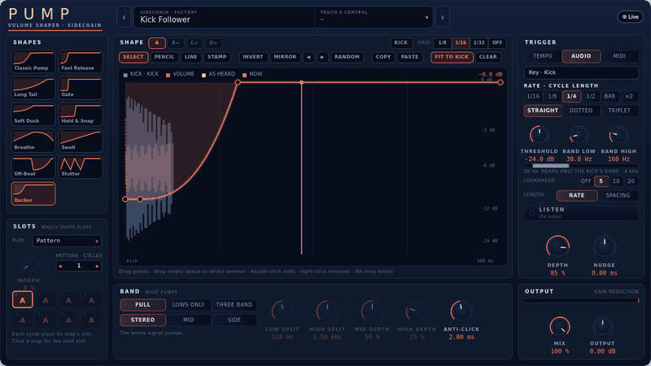

## Stereo and utilities

### Vista

Stereo imager: width per band on the side signal only, with mono bass and a
vectorscope.
[ADR-0040](../../../docs/decisions/0040-native-effect-platform.md)

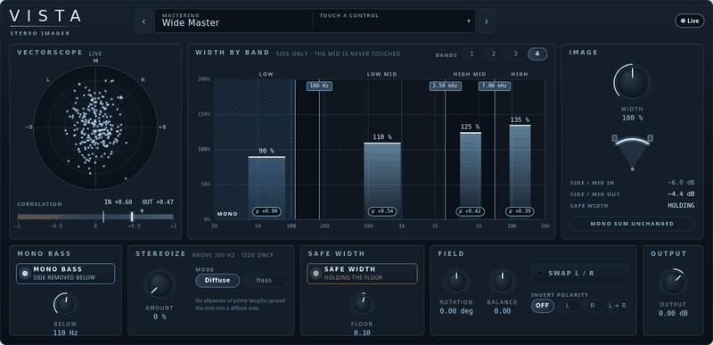

### Trim

Gain, pan, width, mono, swap, polarity, channel solo, DC block and a phase
rotator.
[ADR-0042](../../../docs/decisions/0042-native-utility-suite.md)

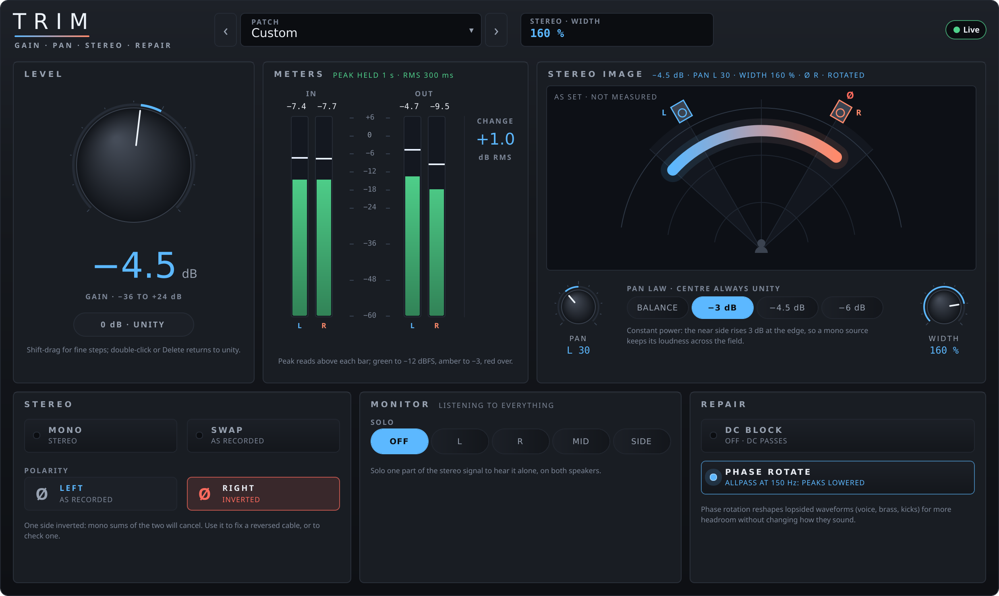

### Lens

Spectrum analyser with a spectrogram and reference matching; audio passes
untouched. Match EQ fits Shape bands that move the mix to the sidechain or
a tonal balance target, and the tonal balance view shows the mix against a
target measured from references.
[ADR-0042](../../../docs/decisions/0042-native-utility-suite.md),
[ADR-0120](../../../docs/decisions/0120-match-eq-and-tonal-targets.md)

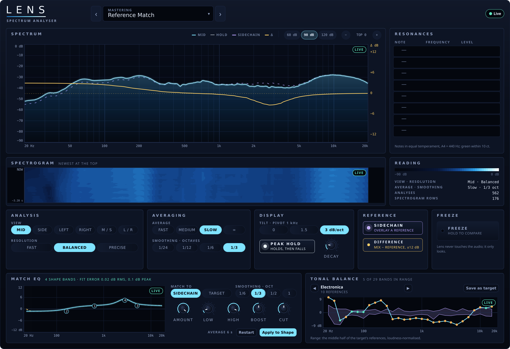

### Loudness

EBU R128 / BS.1770 loudness meter with history and targets; audio passes
untouched.
[ADR-0042](../../../docs/decisions/0042-native-utility-suite.md)

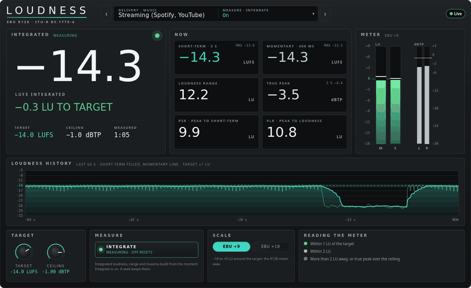

### Scope

Oscilloscope locked to the bar and beat, with the sidechain overlaid and an
alignment meter for the delay and polarity between them.
[ADR-0042](../../../docs/decisions/0042-native-utility-suite.md)

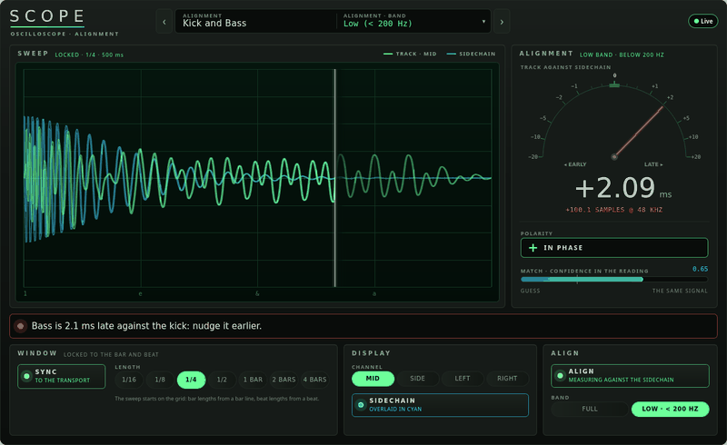

### Tune

Tuner for instruments, bass and kicks; audio passes untouched.
[ADR-0042](../../../docs/decisions/0042-native-utility-suite.md)

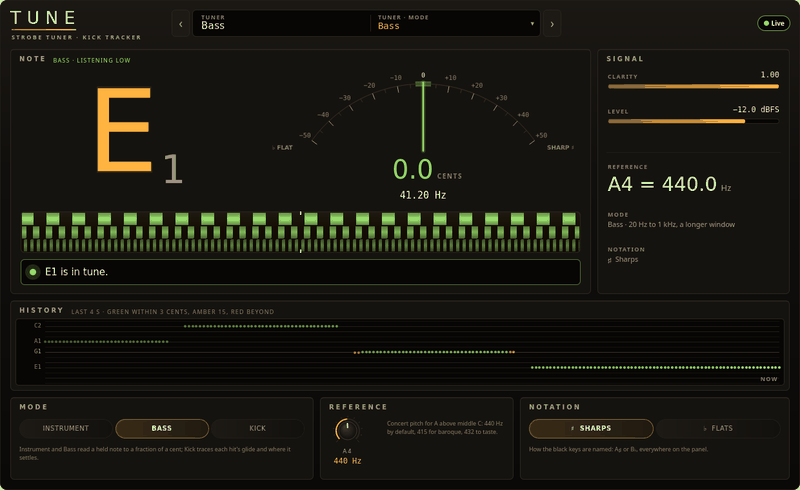

### Signal

Test generator: sine, logarithmic sweep, white and pink noise, and impulse
trains, replacing or added to the input.
[ADR-0042](../../../docs/decisions/0042-native-utility-suite.md)

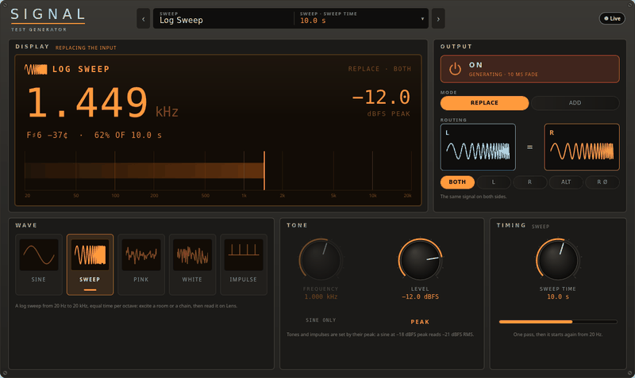
