# Instruments

The native instruments. Each one is a parameter table and a DSP kernel on the
native-synth platform ([ADR-0027](../../../docs/decisions/0027-prism-native-synth.md)),
with its own Qt Quick panel in `apps/daw_quick/qml/<engine>/`. The screenshots
come from the panel tests in `tests/ui/quick/`.

## Prism

Polysynth: two band-limited oscillators with unison, sub, noise and ring, a
2x-oversampled multimode filter, two envelopes, two LFOs, a four-slot matrix,
drive and chorus. [ADR-0027](../../../docs/decisions/0027-prism-native-synth.md)

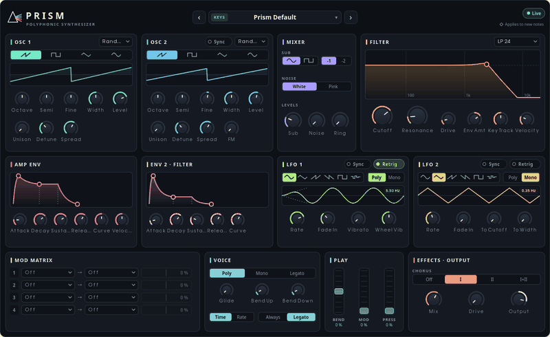

## Ember

Vintage analogue polysynth: mono voice cards with a morphing filter, a circuit
model of component tolerances, drift and hum, and an ensemble, chorus, BBD
delay and tape chain. [ADR-0028](../../../docs/decisions/0028-ember-vintage-synth.md),
[ADR-0066](../../../docs/decisions/0066-ember-circuit-model.md)

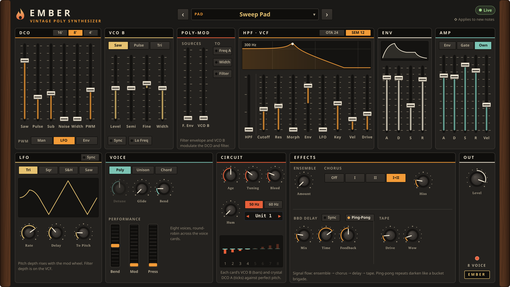

## Nova

Wavetable synth: wavetable oscillators, two filters, a modulation matrix,
an FX rack, an arpeggiator and per-voice analogue tolerances.
[ADR-0057](../../../docs/decisions/0057-nova-flagship-synth.md),
[spec 08](../../../docs/specs/08-nova-synth.md)

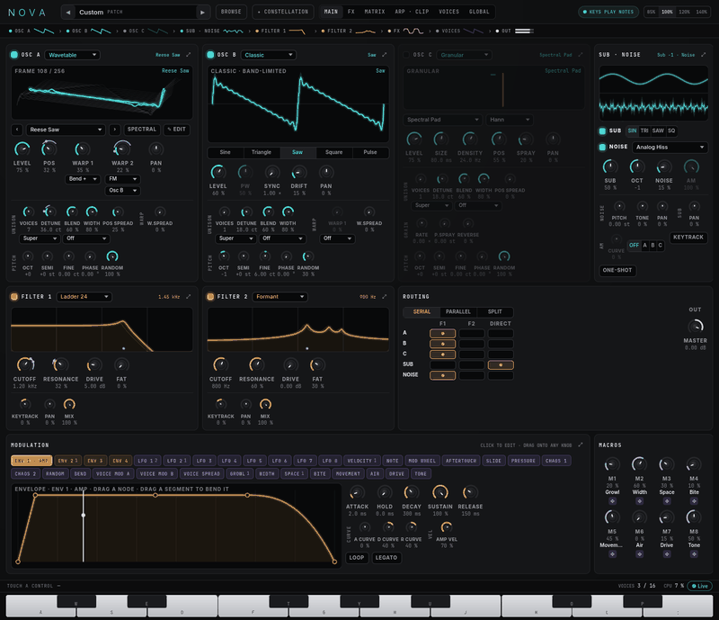

## Pulse

Analogue-modelled drum machine on keys C1 to B1: kicks, snare, rim, clap,
toms, hats, cowbell and cymbal, into a glue compressor and saturation.
[ADR-0030](../../../docs/decisions/0030-pulse-drum-synth.md)

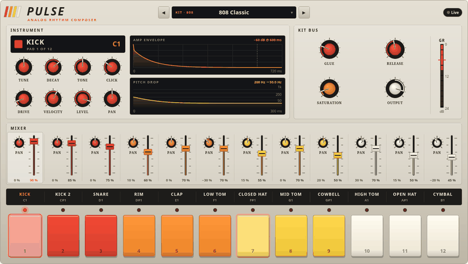

## Halo

Six-operator FM synth over 32 algorithms, 2x oversampled, with an optional
filter, an LFO, unison and an ensemble, chorus and delay chain.
[ADR-0031](../../../docs/decisions/0031-halo-fm-synth.md)

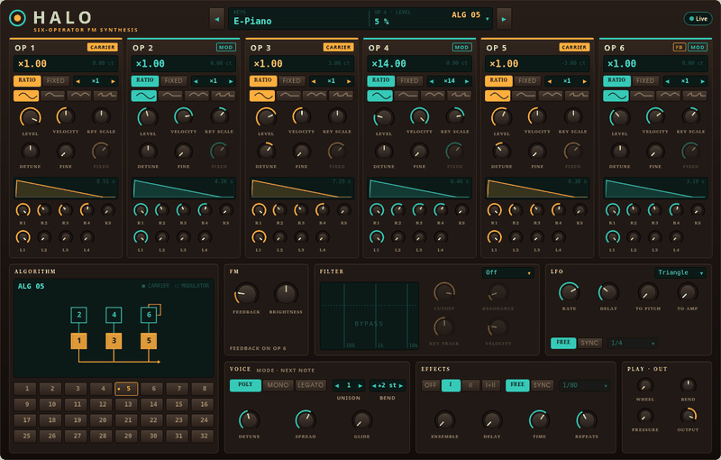

## Torque

Mono bass synth with four models (acid diode ladder, Moog ladder, Reese,
sub/808), accent, slide and a 16-step sequencer.
[ADR-0032](../../../docs/decisions/0032-torque-bass-synth.md)

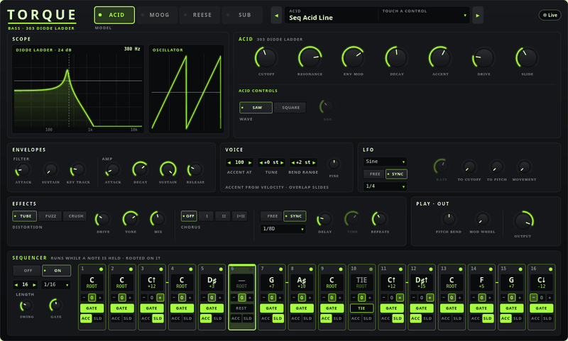

## Drift

Granular texture synth: each note is a cloud of grains drawn from a wavetable,
partials and air source, with freeze and shimmer.
[ADR-0033](../../../docs/decisions/0033-drift-granular-synth.md)

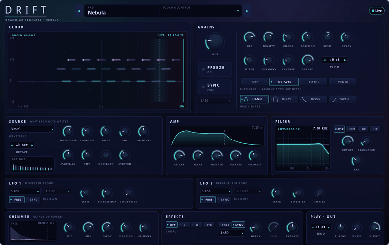

## Anvil

Kick synth: the body's pitch, amplitude and drive are drawn curves over the
hit, with click, sub and tuned rumble layers and a master stage.
[ADR-0060](../../../docs/decisions/0060-anvil-kick-synth.md)

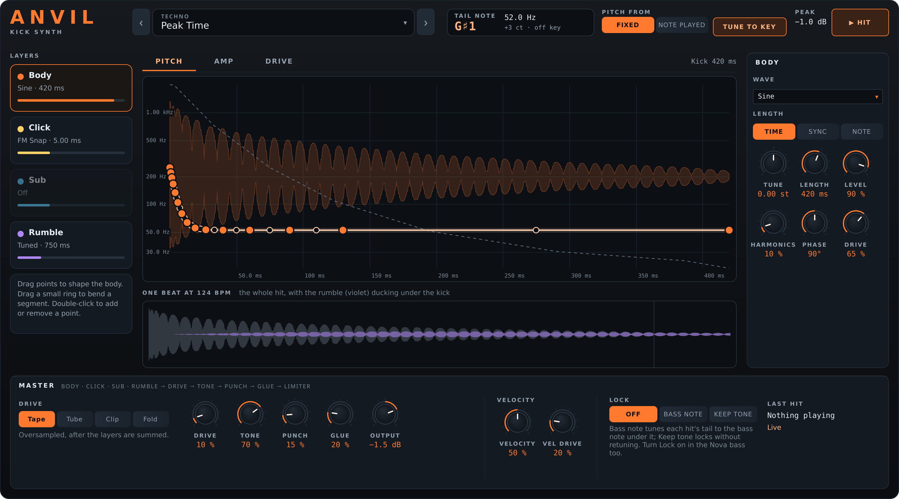

## Knock

Physically modelled percussion: eight pads, each a striker on a modal
resonator with a coupled second resonator and a body.
[ADR-0068](../../../docs/decisions/0068-knock-percussion.md)

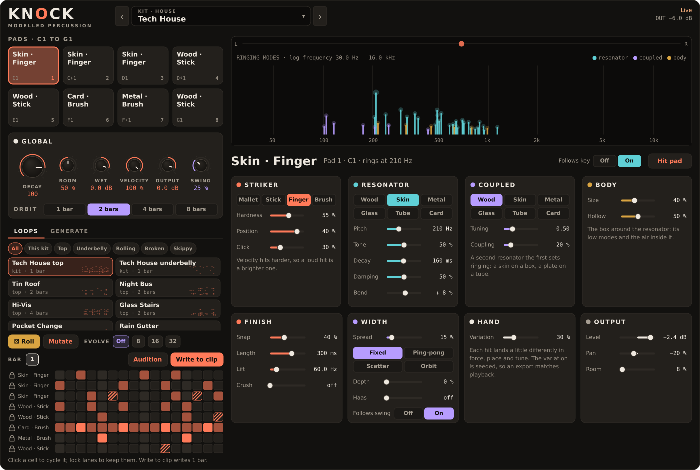

## Crate

Chop sampler: one sample cut into up to 32 chops, played from pads or across
the keyboard, through a vintage era stage.
[ADR-0063](../../../docs/decisions/0063-crate-chop-sampler.md),
[spec 09](../../../docs/specs/09-crate-sampler.md)

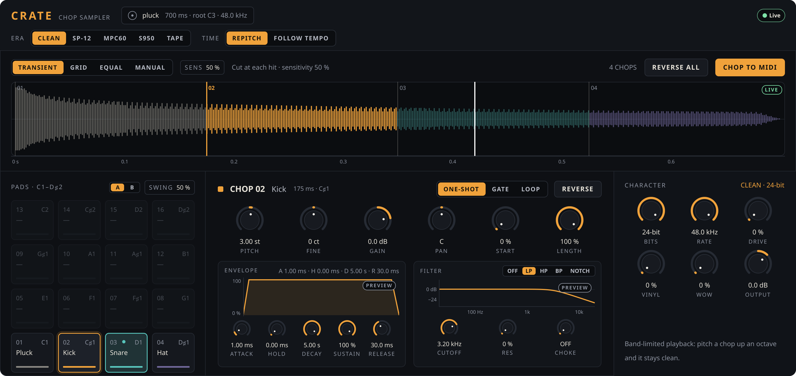

## Concert

Sampled grand piano: the Salamander Grand Piano, streamed from disk, with
damper, sostenuto and una corda pedals.
[ADR-0071](../../../docs/decisions/0071-concert-sampled.md)

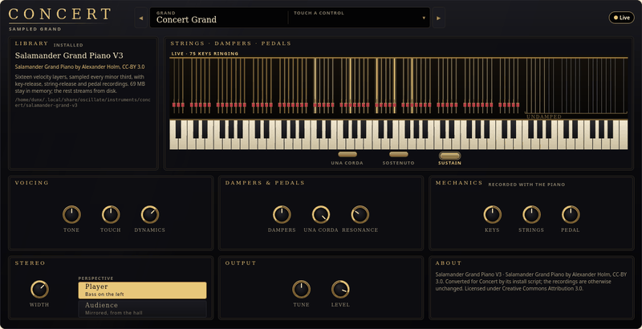

## Fret

Sampled fingered bass: Black and Blue Basses, with Feel choosing accents,
ghosts, staccato and pushes as the notes play.
[ADR-0088](../../../docs/decisions/0088-fret-sampled-bass.md)

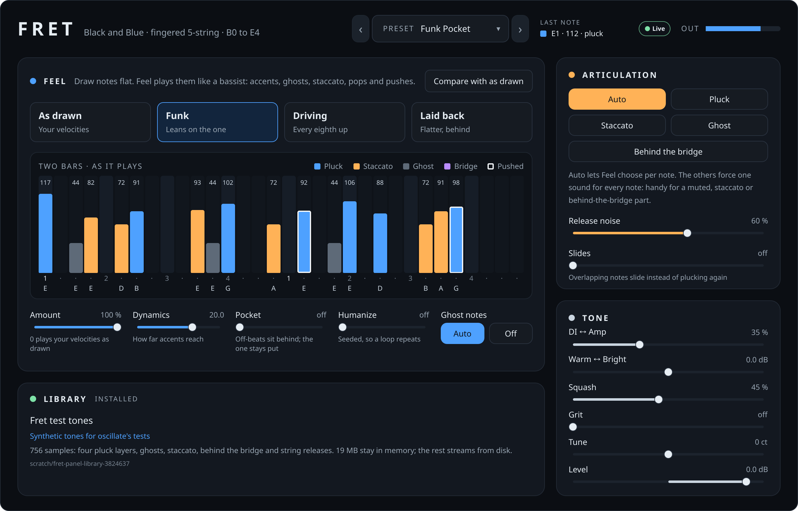

## Wren

Sampled concert flute: the University of Iowa flute samples, with Breath
shaping phrasing, vibrato, swells and grace notes.
[ADR-0089](../../../docs/decisions/0089-wren-sampled-flute.md)

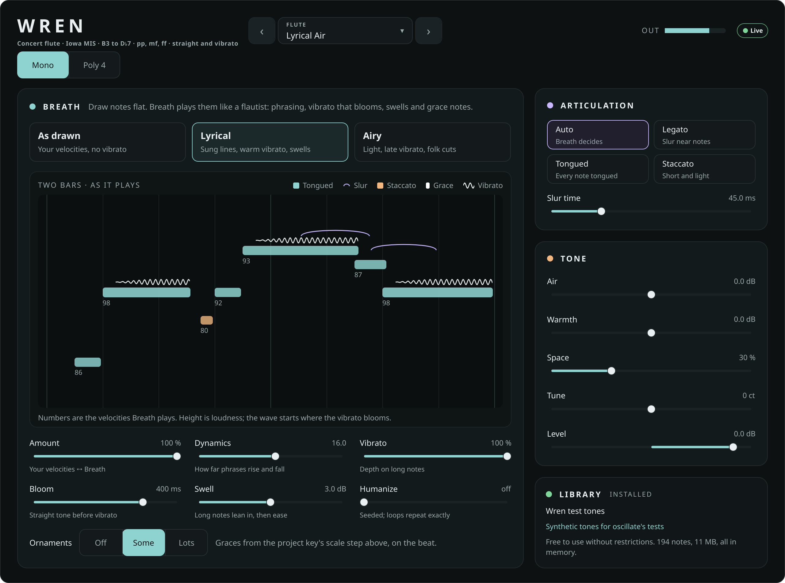

Concert, Fret and Wren need their sample libraries, installed as the
[README](../../../README.md#sample-libraries) describes.
